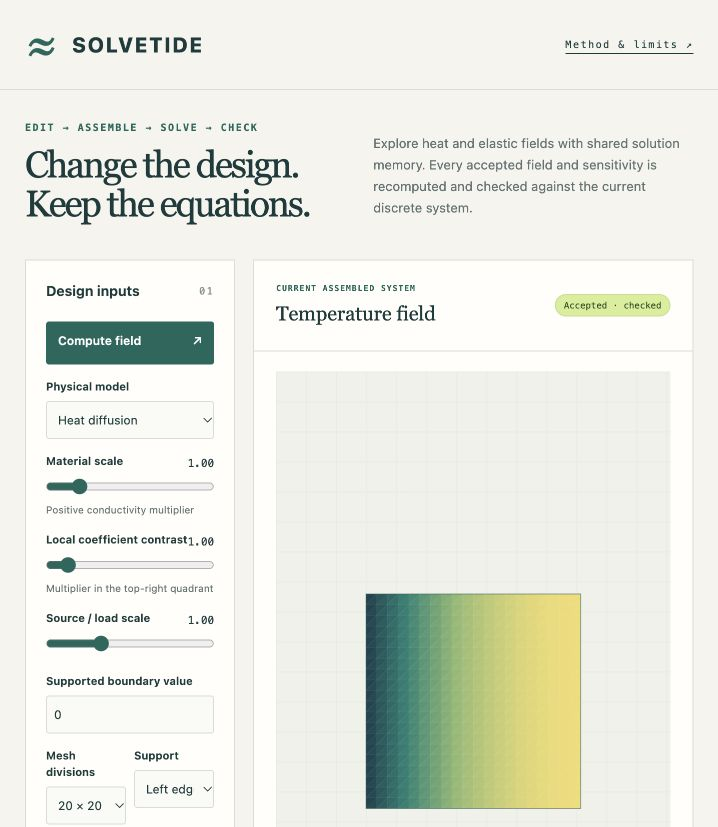
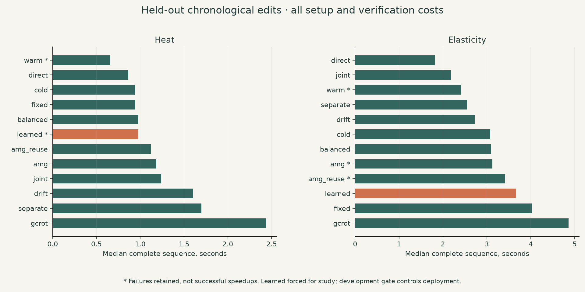

# SolveTide

**Change a design. Recompute the field. Check the equations.**

An installable CPU runtime for sparse heat and linear-elasticity solves, implicit objective gradients and bounded memory reuse across design edits. A local field editor and a separately installed inverse-design application use the same public API.

This is a numerical research preview. The trained joint-memory policy is **disabled by development validation**; ordinary warm starts are the default. Recycling, implicit differentiation and residual checking are established methods. SolveTide does not establish a general acceleration or real-time breakthrough.



[Watch the15-second actual browser replay](https://github.com/nazeeh111/SolveTide/releases/download/v0.1.0/solvetide-0.1.0-demo.mp4). Pauses are edited; it is not a real-time benchmark.

## Run locally

Python 3.12+. No account, API key or network access is needed after installing dependencies.

```sh
git clone --branch v0.1.0 --depth 1 https://github.com/nazeeh111/SolveTide.git
cd SolveTide
python3.12 -m venv .venv
. .venv/bin/activate
python -m pip install -e .
solvetide studio
```

Open `http://127.0.0.1:8765`. The server binds only to loopback and loads no external assets. Adjust the conductivity/elastic modulus, local material contrast, source/load or supported boundary value, then compute. Inspect true residuals, backward error, gradients, memory and cache events. Changing controls marks the old picture stale and disables export. The editor includes an invalidating mesh edit, a one-iteration failure and a fresh sparse-direct fallback.

Download the pinned wheel from [v0.1.0](https://github.com/nazeeh111/SolveTide/releases/tag/v0.1.0) for an installed version. Release assets and source are described in [the reproduction guide](docs/reproducibility.md).

## Use the runtime

A gradient describes how the objective changes with a parameter. The adjoint is an auxiliary transpose-system solve used to compute those sensitivities.

```python
from solvetide import assemble, Runtime, SolverConfig

runtime = Runtime(SolverConfig(strategy="joint", memory_budget=12))
for contrast in (2.0, 2.1):
    system = assemble("heat", n=24, parameters={"contrast": contrast})
    forward = runtime.solve(system)
    sensitivity = runtime.gradient(system, forward, target=0.12)
    if not sensitivity.accepted:
        raise RuntimeError(sensitivity.status)
    print(sensitivity.objective, sensitivity.gradient)
```

`assemble("elasticity", ...)` uses the same solver and gradient interfaces. The supported assemblers establish positive definiteness using positive materials and prescribed boundaries. External matrices require a caller-established SPD contract. SPD means symmetric positive definite, the mathematical condition required by the conjugate-gradient method.

```sh
solvetide solve --family heat --n 24 --contrast 2 --output result.json
solvetide verify result.json
# A separate standard-library implementation can check the stored equations:
python solvetide/checker.py result.json
```

Every exported CLI result includes actual CSR equations, forward and adjoint vectors, discrete derivatives, mesh/constraint identities, tolerances and a content digest. The checker recomputes residuals and the adjoint contraction with standard-library arithmetic. It does not certify physical truth or a solution-error enclosure. Existing output paths refuse overwriting.

## What is implemented

| Capability | Scope |
| --- | --- |
| Heat | Scalar diffusion on bounded unit-square P1 triangle meshes |
| Elasticity | Plane-strain isotropic linear elasticity, fixed Poisson ratio 0.3 |
| Parameters | Global positive material, top-right-quadrant contrast, uniform source/vertical body load, prescribed temperature/vertical displacement |
| Boundaries | Left, right, both vertical edges, or all edges prescribed; remaining edges have zero natural flux/traction |
| Gradients | Original constrained-system implicit adjoints for all four parameters |
| Reuse | Warm starts; orthogonal shared correction space; fixed, drift, joint and trained paired quota/refresh policies |
| Controls | Exact-operator LU reuse, fixed SciPy GCROT, rebuilt/reused symmetric AMG, fixed shared and separate 6+6 memory |
| Safety | Original residual and normwise backward-error checks, byte identities, rank checks, mapping invalidation, finite inputs, explicit failure/cancel/work states |

The correction memory supplies a **projected initial guess followed by ordinary classical iterations**. It is not a full augmented-CG implementation. The small ridge model chooses forward/adjoint memory quotas and a refresh/skip action; it never predicts accepted fields or gradients. New operators always get fresh matrix-applied products. Unsupported mesh/constraint mappings discard state. Restart starts with empty memory.

## Evidence and limits

The frozen study executed **288 runs and 2,880 edits** across 12 methods, both families and three repeats. 28 paired adjoints refused the declared tolerance. Accepted held-out reference errors reached 5.34e-6 for fields and 7.79e-6 for gradients, illustrating why residuals alone are not solution-error bounds. The trained policy remained disabled.

The complete inverse-design study recorded 36 attempts: 30 completed; six iterative elasticity attempts stopped on an adjoint refusal. Sparse direct completed all six family/repeat cases and was the fastest successful method in this small study. Early refusals are not speedups. Use `solvetide-design --family elasticity --strategy direct` for the verified elasticity client example.

Actual changed-input editor requests at 20/32/48 edge divisions had local median complete responses of 32–479 ms, including computation and JSON transport/parse. Browser painting is excluded, only three observations were taken per row, and no hard latency or real-time guarantee follows. [Full measured tiers and qualifications](docs/measurements.md).



[Independent numerical checks](experiments/numerical-validation.json) compare both families with separate direct solves, decimal-residual refinement on small problems, finite differences over five step sizes and mesh-refinement studies. Rejected high-contrast cases demonstrate why a small residual alone does not imply an accurate solution.

[Research foundations](docs/research.md), [discrete equations](docs/equations.md), [runtime contracts](docs/runtime.md), [architecture](docs/architecture.md), [API/status reference](docs/api.md), [reproduction](docs/reproducibility.md) and [owner walkthrough](docs/walkthrough.md) explain implementation and limits. [Measured confirmation, optimization and memory results](docs/measurements.md) retain all failures and full traces.

No nonlinear fluids, arbitrary remeshing, universal PDE support, GPU dependence or safety-critical design certification. Solver error, spatial discretization error and physical-model error are distinct. Reported convergence concerns stored discrete equations. Large contrasts can fail; failures expose no current field or gradient. Cancellation is cooperative around opaque assembly/factor setup. Conservative factor-storage bounds are checked before allocation and actual storage afterward; opaque factorization workspace is outside that bound. These checks are not a process memory cap.

## Develop

```sh
python -m pip install -e '.[dev,study]'
OPENBLAS_NUM_THREADS=1 OMP_NUM_THREADS=1 python -m pytest -q
python -m studies.run train
python -m studies.run confirm
python -m studies.optimization
python -m studies.memory
python -m studies.validate
python -m build --no-isolation
```

CPU experiments use original synthetic trajectories and MIT-licensed trained weights. Dependencies retain their own [licenses](docs/licenses.md). No copied external solver implementation or pretrained data is bundled. [MIT](LICENSE).
