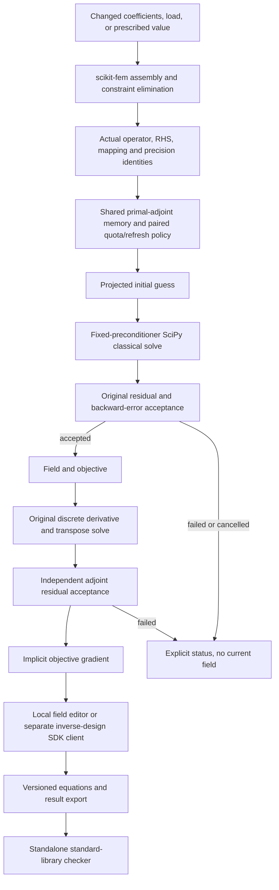

# Architecture

The editable diagram source is [architecture.mmd](architecture.mmd). The solver is independent of the field editor. The external application in `integration/design_app` installs as a second distribution and imports only public runtime interfaces.

`assembly.py` owns constrained discrete equations and analytic parameter derivatives. `runtime.py` owns the process-local cache, correction bank, classical methods and acceptance. `policy.py` owns compact data-only joint-action weights. `artifacts.py` owns versioned CLI exports and `checker.py` independently recomputes their stored-equation checks. `server.py` serializes editing work and revokes obsolete results.

A correction bank stores at most the configured number of orthonormal vectors shared between primal and adjoint solves. The trained plan assigns role quotas summing to that budget and a refresh/skip choice; rank is actual valid available directions, not reserved empty slots. Changed operator products are recomputed. Changed mesh, DOF ordering, constraints or precision revoke mappings. No factorization is reused under a different operator identity. Failed candidates do not become accepted memory.

This release does not persist reusable memory to disk. A restart is an empty runtime; exported results are evidence, never silently loaded as a solve cache. Replaying exported inputs reassembles and recomputes.
